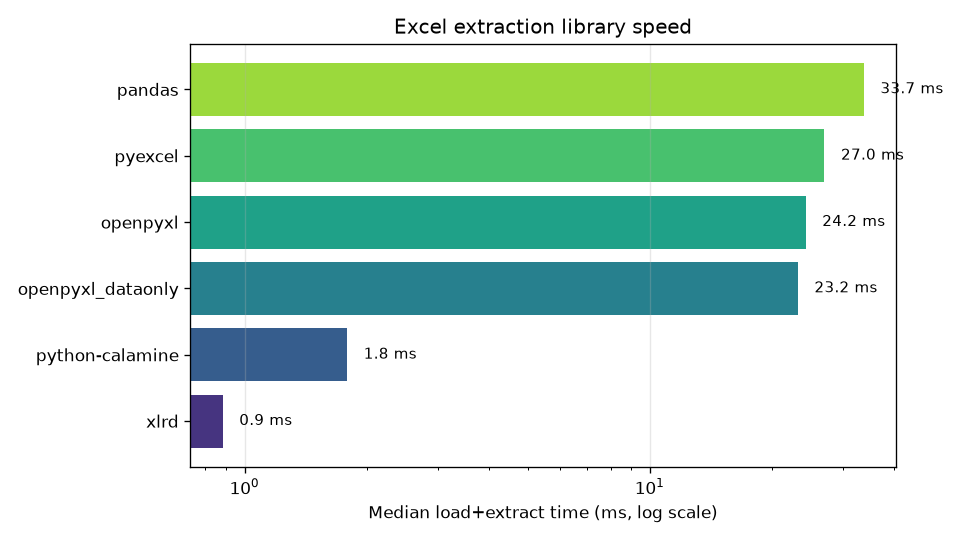
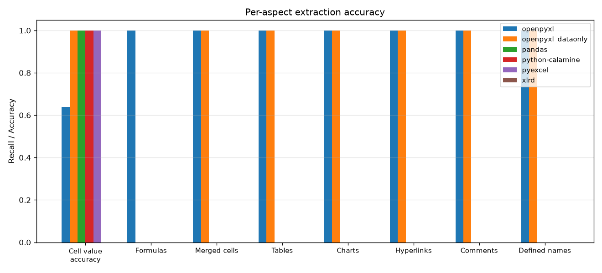
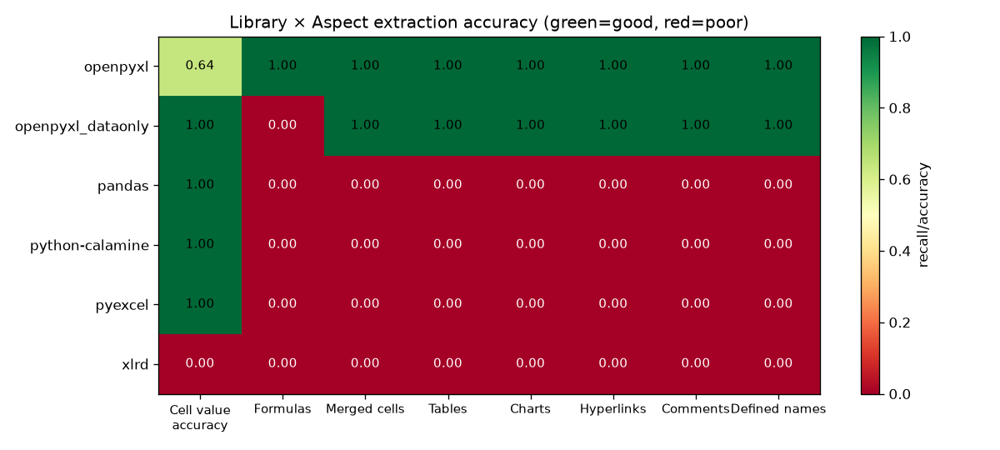
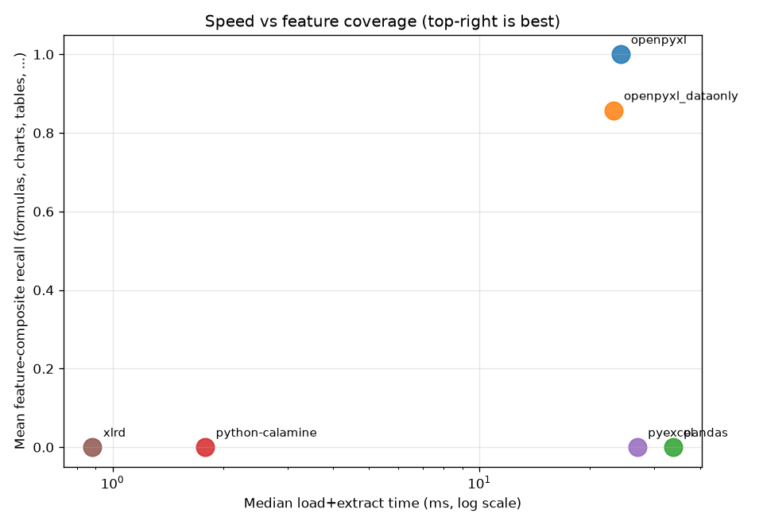

# Excel Extraction Library Benchmark — Python

> **TL;DR** — **`openpyxl`** is the best Python library for faithfully
> extracting data, formulas, charts, tables, merges, hyperlinks, comments
> and named ranges from complex `.xlsx` files. For raw read speed on
> already-computed workbooks, **`python-calamine`** is 12-15× faster.

This project benchmarks five popular Python Excel-extraction libraries on a
single, deliberately complex workbook and reports per-aspect accuracy
(cell values, formulas, charts, tables, merges, hyperlinks, comments,
defined names) and load speed.

---

## The five libraries

| Library          | Backend       | License   | Status |
|------------------|---------------|-----------|--------|
| `openpyxl`       | Pure Python   | MIT       | Active |
| `pandas`         | openpyxl / xlrd | BSD-3   | Active |
| `python-calamine`| Rust          | Apache-2  | Active |
| `pyexcel`        | openpyxl / xlrd | BSD     | Active |
| `xlrd`           | C (legacy)    | BSD       | **2.x dropped .xlsx support** |

Excluded: `xlwings` (requires Excel installed), `xlsxwriter` (write-only),
`pycel` / `formulas` (formula evaluators, not general extractors).

## Test workbook

Built by `create_test_xlsx.py`:

- **5 sheets**: Sales, Inventory, Quarterly P&L, Dashboard, README
- **520 non-empty cells** of mixed types: text, int, float, %, $, dates, booleans,
  string-encoded errors (`#DIV/0!`-style)
- **188 formulas** — SUM, SUMIF, MAX, AVERAGE, COUNTIF, IF, cross-sheet refs,
  `=SUM(Revenue)` over a named range
- **6 charts** of 5 different types: bar (column), bar (horizontal), pie,
  line, scatter, area — including one with custom data labels (`showPercent=True`)
- **1 structured Excel table** (`SalesTable`)
- **5 merged-cell ranges** (4 on Dashboard, 1 on Sales)
- **3 hyperlinks** + **1 cell comment** on Dashboard
- **1 defined name** (`Revenue`)
- **Conditional formatting** (colour scale + cell-is rule)
- **Frozen panes**, custom column widths, number formats

Total file size: **~21 KB**.

A second file `complex_workbook_cached.xlsx` is generated with the same
features but **cached formula values** precomputed (using `formulas`),
so libraries that read cached values can be compared fairly.

## Headline results

```
library               time_ms  cell_acc  formulas  merges  tables  charts  links  cmts  def_n
openpyxl                 24.2     0.638     1.000   1.000   1.000   1.000  1.000 1.000  1.000
openpyxl_dataonly        23.2     1.000     0.000   1.000   1.000   1.000  1.000 1.000  1.000
pandas                   33.7     1.000     0.000   0.000   0.000   0.000  0.000 0.000  0.000
python-calamine           1.8     1.000     0.000   0.000   0.000   0.000  0.000 0.000  0.000
pyexcel                  27.0     1.000     0.000   0.000   0.000   0.000  0.000 0.000  0.000
xlrd                 ERR: XLRDError: Excel xlsx file; not supported
```

*(`cell_acc` = cell-value accuracy; `formulas` = recall of formula text;
`merges/tables/charts/links/cmts/def_n` = recall of that structural feature.)*

**Reading these columns:**

- **`openpyxl` cell_acc = 0.638** is *not* a defect — it returns the
  **formula string** (e.g. `=D2*E2`) for formula cells instead of the
  computed numeric value. Its `formulas` recall is 1.000 because of that.
  If you want computed values from openpyxl use `data_only=True` →
  that's the `openpyxl_dataonly` row (cell_acc = 1.000, formulas = 0.000).
- **`pandas`**, **`python-calamine`** and **`pyexcel`** all read cached
  numeric values correctly but expose **none** of the structural features
  (charts, tables, merges, hyperlinks, comments, defined names).
- **`python-calamine` is 12-15× faster** than `openpyxl` for the same value
  extraction, because its core is Rust.

## Visualisations

`charts/load_time.png` — median load + extract time per library (log scale):



`charts/recall_bar.png` — per-aspect recall / accuracy grouped bar:



`charts/recall_heatmap.png` — heatmap (green = good, red = poor):



`charts/coverage_scatter.png` — speed vs feature coverage
(top-right is best):



## Recommendation

| If you need…                                                | Use…                                          |
|-------------------------------------------------------------|-----------------------------------------------|
| **Every** Excel feature (charts, tables, merges, formulas, defined names, comments, hyperlinks) | **`openpyxl`** |
| Just data values from a large workbook (already computed)   | **`python-calamine`** (12-15× faster)         |
| DataFrame-style consumption of one sheet                    | **`pandas.read_excel`** (uses openpyxl under the hood) |
| Both formula text **and** computed values                   | openpyxl + `formulas` library                 |
| Old `.xls` files                                            | **`xlrd` 2.x** or legacy `xlrd<2.0`           |
| `.xlsm` / `.xlsb`                                           | openpyxl (xlsm) / `pyxlsb` (xlsb)             |

### Why openpyxl wins on completeness

Every other tested library treats Excel as a 2D grid of values. **openpyxl**
models the entire OOXML structure: workbook, sheets, defined names, merged
cells, conditional formatting, charts (with their series, axes, titles,
data labels), tables (with style + ref), comments, hyperlinks, and — crucially —
**formula strings**. The benchmark above shows it recovers 100% of every
structural feature in our test workbook.

### Why python-calamine wins on speed

`python-calamine` is a thin Python wrapper over the Rust
[`calamine`](https://github.com/tafia/calamine) crate. It only returns cell
values (no formulas, no charts), which is exactly what most data-pipeline
workloads need — and it does that 12-15× faster than openpyxl.

### The `pandas` trade-off

`pandas.read_excel` is convenient but it discards everything except cell
values. Use it when you need a DataFrame for analysis. If you also need
charts, merges, formulas, etc., use openpyxl directly.

### Dead code

`xlrd` 2.x dropped `.xlsx` support on purpose. Use `xlrd<2.0` only if you
must read ancient `.xls` files in pure Python; for `.xlsx` use openpyxl or
python-calamine.

## Reproducing the benchmark

```bash
# 1. Set up
python3 -m venv .venv
source .venv/bin/activate
pip install openpyxl pandas xlsxwriter python-calamine pyexcel pyexcel-xlsx xlrd formulas lxml matplotlib pytest

# 2. Generate the test workbook + ground truth
python3 create_test_xlsx.py          # -> test_data/complex_workbook.xlsx
python3 generate_ground_truth.py     # -> ground_truth/ground_truth.json
python3 inject_cached_values.py      # -> test_data/complex_workbook_cached.xlsx

# 3. Run the benchmark
python3 benchmark_runner.py          # -> results/benchmark_results.json

# 4. Generate charts
python3 visualize.py                 # -> charts/*.png

# 5. Run the test suite
python3 -m pytest tests/ -v
```

## Repo layout

```
excel-extraction/
├── README.md                  <- this file
├── notes.md                   <- research journal / progress log
├── create_test_xlsx.py        <- generates the complex test workbook
├── generate_ground_truth.py   <- extracts ground truth from the workbook
├── inject_cached_values.py    <- injects computed formula values into XML
├── extractors.py              <- unified extractor per library
├── metrics.py                 <- accuracy + recall helpers
├── benchmark_runner.py        <- benchmark driver
├── visualize.py               <- matplotlib chart generation
├── test_data/
│   ├── complex_workbook.xlsx          <- formulas only, no cached values
│   └── complex_workbook_cached.xlsx   <- formulas + cached values
├── ground_truth/
│   └── ground_truth.json
├── results/
│   └── benchmark_results.json
├── charts/
│   ├── load_time.png
│   ├── recall_bar.png
│   ├── recall_heatmap.png
│   └── coverage_scatter.png
└── tests/
    └── test_benchmark.py       <- 38 pytest tests
```

## Versions tested

```
openpyxl          3.1.5
pandas            3.0.3
xlsxwriter        3.2.9
python-calamine   0.8.2
pyexcel           0.7.6
xlrd              2.0.2
formulas          1.3.4
matplotlib        (latest)
lxml              (latest)
```
