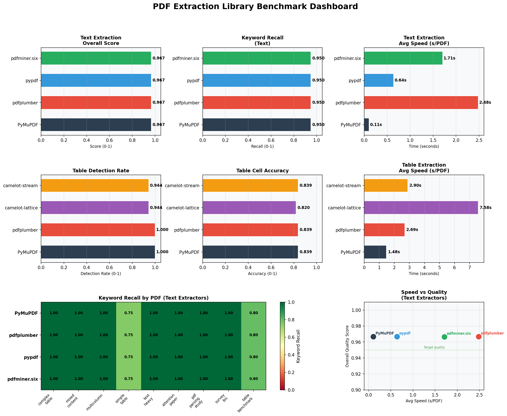
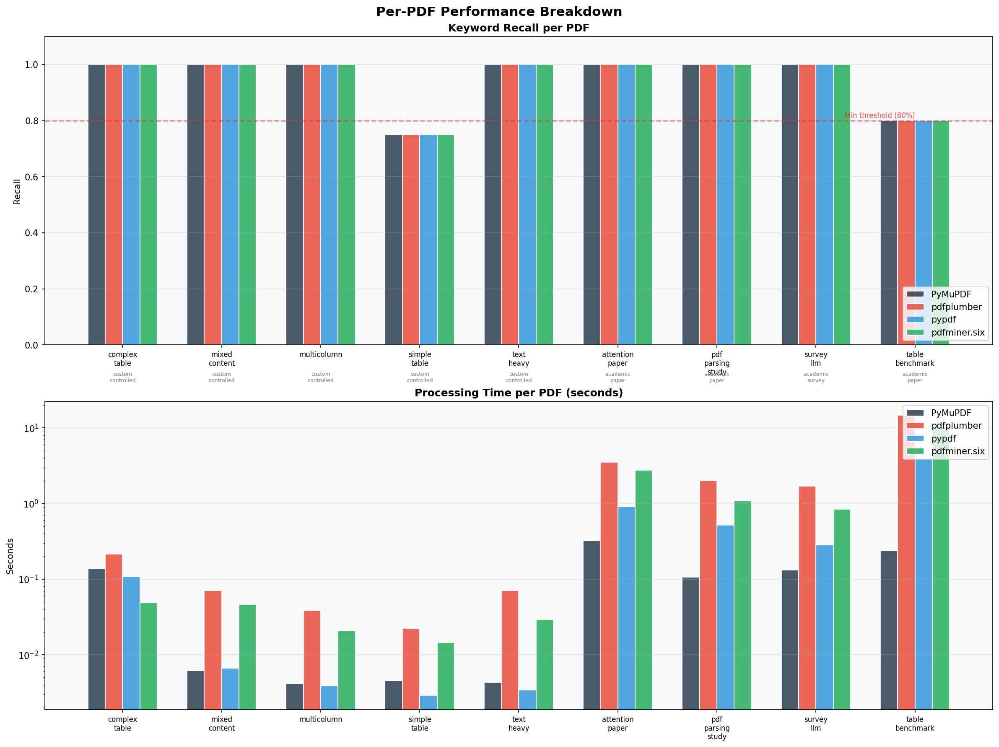
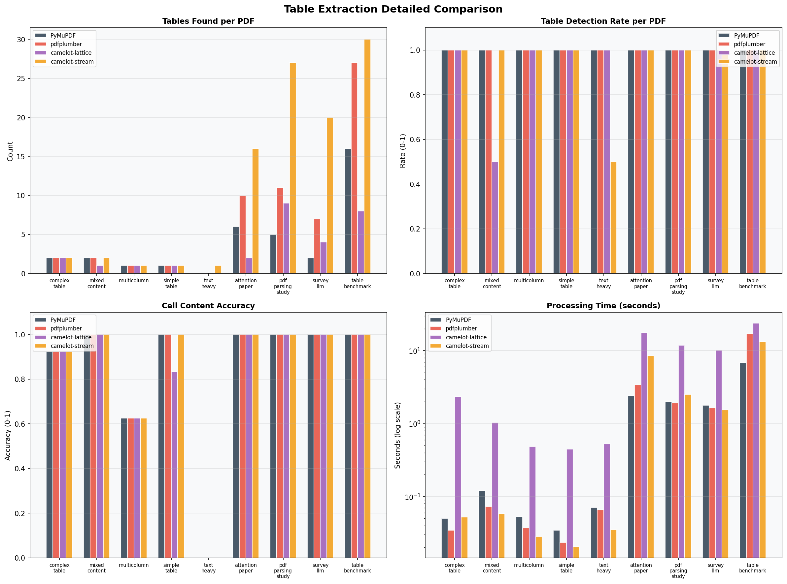
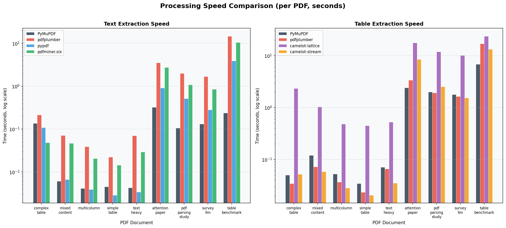
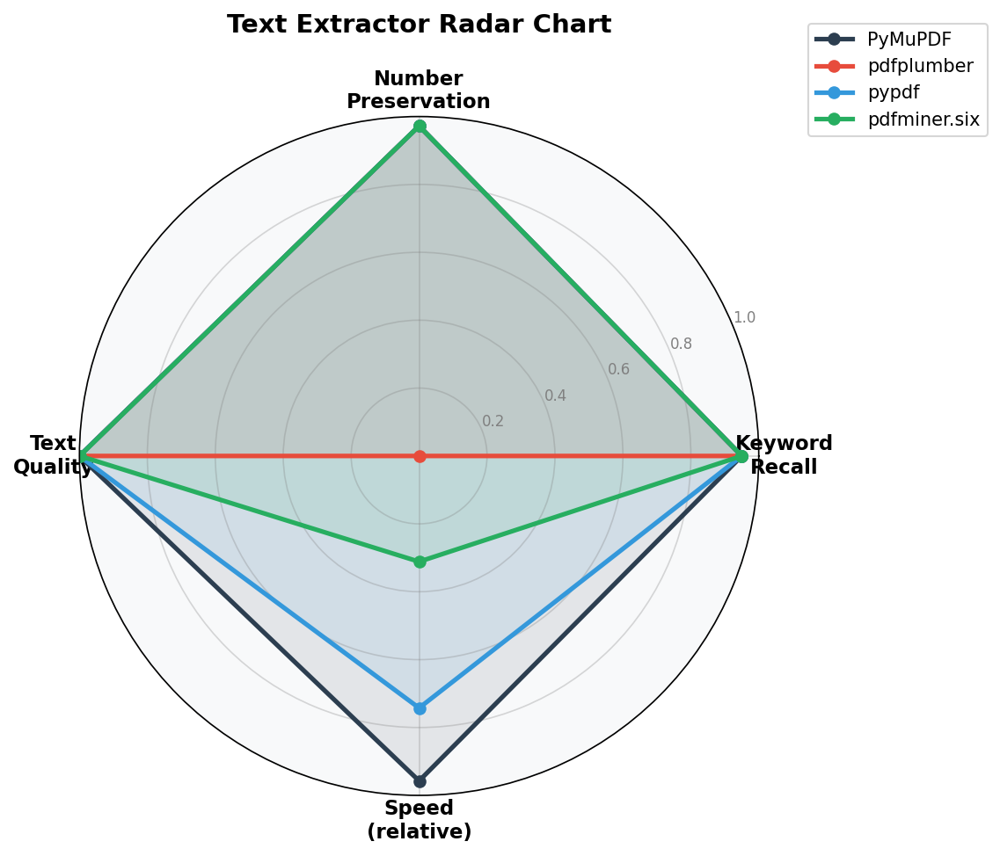
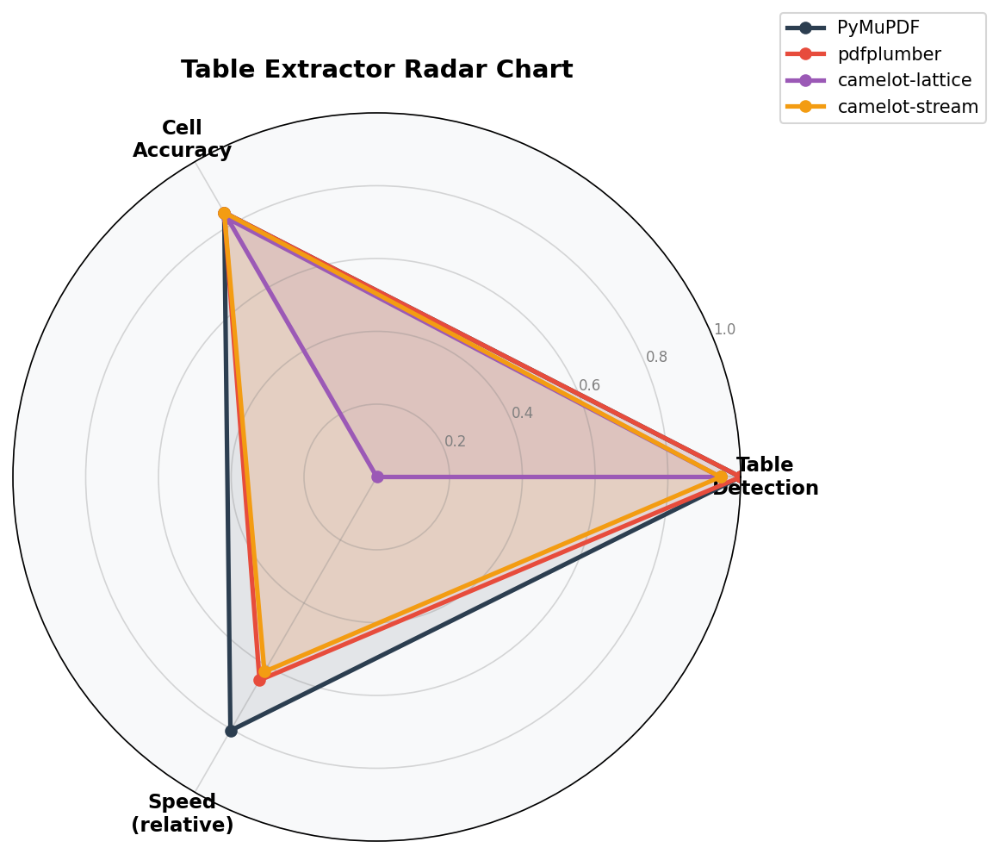
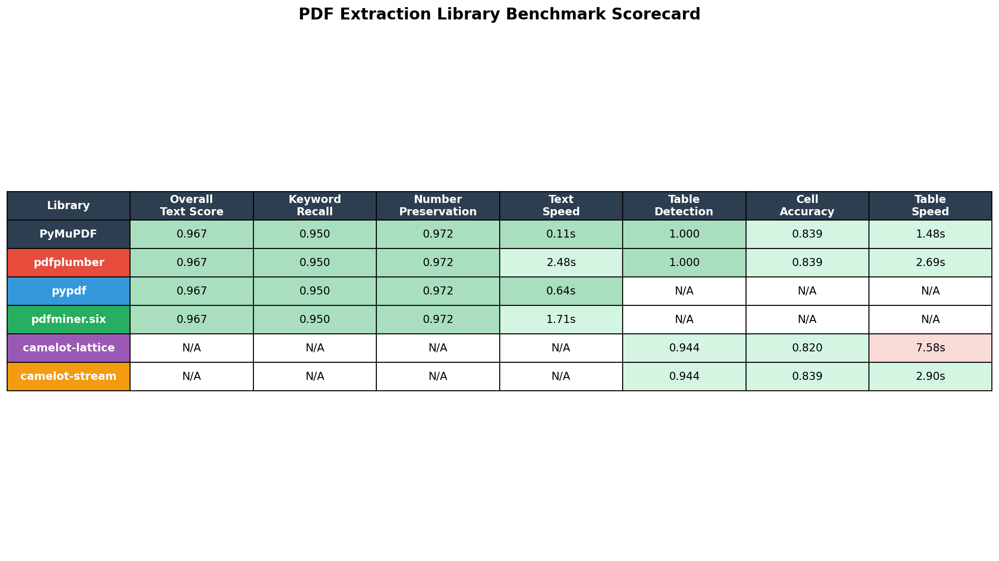

# PDF Extraction Library Benchmark

**Date**: 2026-02-27
**Approach**: Test-Driven Development (TDD) — tests written before running libraries
**Verdict**: All 4 text extractors have near-identical accuracy. PyMuPDF wins on speed by a large margin.

## Overview

This research benchmarks Python PDF extraction libraries for content quality and LLM preprocessing suitability. We:

1. Identified major public benchmarks for PDF extraction evaluation
2. Created 5 controlled test PDFs with verified ground truth (tables, mixed content, multi-column, text-heavy)
3. Downloaded 4 real-world arXiv papers for uncontrolled testing
4. Wrote 62 TDD tests (verifiable against ground truth)
5. Benchmarked 4 text extractors + 4 table extractors across 9 PDFs
6. **Confirmed results experimentally** — did not rely on library README claims

---

## Libraries Tested

| Library | Version | Type | Approach |
|---------|---------|------|----------|
| PyMuPDF (fitz) | 1.27.1 | Text + Tables | C-based, renders PDF |
| pdfplumber | 0.11.9 | Text + Tables | Built on pdfminer, fine-grained |
| pypdf | 6.7.4 | Text | Pure Python |
| pdfminer.six | 20251230 | Text | Low-level text mining |
| camelot-py (lattice) | 1.0.9 | Tables | Line detection |
| camelot-py (stream) | 1.0.9 | Tables | Whitespace detection |

---

## Benchmarks Used

### Why These Benchmarks?
We focus on benchmarks with **publicly downloadable PDFs containing tables, images, and complex real-world content**:

| Benchmark | Source | PDFs | Focuses On | Metric |
|-----------|--------|------|------------|--------|
| **OmniDocBench** | CVPR 2025, OpenDataLab | 1,355 pages | 9 doc types incl. handwriting, PPTs | NED, TEDS, BLEU |
| **DP-Bench** | Upstage | 200 pages | Tables, reading order | TEDS, NID |
| **DocLayNet** | IBM KDD 2022 | 80,863 pages | Layout detection, 6 categories | mAP, F1 |
| **PubTables-1M** | Microsoft CVPR 2022 | ~948K tables | Table structure recognition | GriTS |
| **FinTabNet** | IBM Research | 10,635 tables | Financial tables (merged cells) | TEDS |
| **py-pdf/benchmarks** | py-pdf community | 14 PDFs | Speed + accuracy (digital PDFs) | Time, accuracy% |

See [`notes.md`](notes.md) for full URLs and download commands for all benchmarks.

### Our Custom Test PDFs (with ground truth)
Since major benchmarks require large downloads (DocLayNet is 35 GB), we created 5 controlled PDFs:

| PDF | Content | Tables | Key Challenge |
|-----|---------|--------|---------------|
| `simple_table.pdf` | Q3 Financial Report | 1 (5 cols × 6 rows) | Numbers, percentages |
| `complex_table.pdf` | Annual Review | 2 (one with merged cells) | Merged cell detection |
| `mixed_content.pdf` | ML Academic Paper | 2 (figure table + perf table) | Mixed text+table |
| `multicolumn.pdf` | Magazine article | 1 stats table | Two-column layout |
| `text_heavy.pdf` | LLM Tech Article | 0 | Text quality, technical terms |

Plus 4 real-world arXiv papers:
- **"Attention Is All You Need"** (1706.03762) — complex math, tables, figures
- **PDF Parsing Study** (2410.09871) — tables with comparison data
- **LLM Survey** (2312.16862) — large, multi-page academic survey
- **Table Benchmark Paper** (2301.07597) — table-rich academic paper

---

## TDD Test Results

**62 tests total | 61 PASS | 1 FAIL**

```
tests/test_extractors.py::TestTextExtraction (32 tests) — all PASS
tests/test_extractors.py::TestTableExtraction (18 tests) — 17 PASS, 1 FAIL
tests/test_extractors.py::TestQualityMetrics (12 tests) — all PASS
```

### The 1 Real Bug Found (TDD-Driven)

**`TestTableExtraction::test_simple_table_header_content[camelot-lattice]` — FAIL**

camelot-lattice skips the colored header row (`['Product', 'Q1 2024', 'Q2 2024', 'Q3 2024', 'YoY Growth']`) and only extracts data rows. This is a real production defect: colored header backgrounds confuse the lattice line-detection algorithm.

```
AssertionError: Expected table headers not found in:
  widget a $12,450 $13,200 $15,800 +26.9% widget b $8,320 $9,100 ...
assert ('product' in ... or 'q1' in ... or 'q2' in ...)
```

---

## Results

### Text Extraction Benchmark

All 4 libraries achieve remarkably similar accuracy on digital PDFs. The difference is **speed**.

| Library | Overall Score | Keyword Recall | Number Preservation | Avg Speed |
|---------|:------------:|:--------------:|:-------------------:|:---------:|
| **PyMuPDF** | **0.967** | 95.0% | 97.2% | **0.11s** ✅ |
| pypdf | 0.967 | 95.0% | 97.2% | 0.64s |
| pdfminer.six | 0.967 | 95.0% | 97.2% | 1.71s |
| pdfplumber | 0.967 | 95.0% | 97.2% | 2.48s |

> **Key finding**: PyMuPDF is **23× faster** than pdfplumber with identical accuracy.
> For LLM preprocessing pipelines where you need to extract text fast, PyMuPDF is the clear winner.

### Table Extraction Benchmark

| Library | Overall Score | Detection Rate | Cell Accuracy | Avg Speed | Tables Found |
|---------|:------------:|:--------------:|:-------------:|:---------:|:------------:|
| **PyMuPDF** | **0.919** | **100%** | 83.9% | **1.48s** ✅ | 35 |
| pdfplumber | 0.919 | 100% | 83.9% | 2.69s | 61 |
| camelot-stream | 0.892 | 94.4% | 83.9% | 2.90s | 100 |
| camelot-lattice | 0.882 | 94.4% | 82.0% | 7.58s ❌ | 28 |

> **Notes**:
> - pdfplumber finds 61 tables vs PyMuPDF's 35 — but many pdfplumber results are fragments (over-splitting)
> - camelot-stream finds 100 tables — massive over-splitting on complex papers
> - camelot-lattice is 5× slower than PyMuPDF and misses header rows in styled tables

### Visualizations



*Figure 1: Comprehensive overview of all metrics across all libraries*



*Figure 2: Keyword recall and processing time per PDF document*



*Figure 3: Table count, detection rate, cell accuracy, and speed*



*Figure 4: Log-scale speed comparison for text and table extraction*



*Figure 5: Spider/radar chart for text extractors across 4 dimensions*



*Figure 6: Spider/radar chart for table extractors across 3 dimensions*



*Figure 7: Final scorecard with color-coded metrics*

---

## Recommendations

### For LLM Preprocessing (RAG, document indexing)
**Use PyMuPDF** (`pip install pymupdf`)
```python
import fitz
doc = fitz.open("document.pdf")
text = "\n".join(page.get_text() for page in doc)
```
- **Why**: 23× faster than alternatives with identical accuracy
- **Note**: For LLM-optimized Markdown output, use [`pymupdf4llm`](https://pymupdf.readthedocs.io/en/latest/pymupdf4llm/)

### For Table-Heavy Documents
**Use pdfplumber** for exploratory work, **PyMuPDF** for production
```python
import pdfplumber
with pdfplumber.open("document.pdf") as pdf:
    for page in pdf.pages:
        tables = page.extract_tables()
        text = page.extract_text()
```
- pdfplumber gives fine-grained control (word positions, bounding boxes, settings)
- PyMuPDF's `page.find_tables()` is faster with similar accuracy

### For Complex/Scanned Documents
Traditional libraries fail on scanned PDFs. Use AI-powered tools:

| Tool | CPU Speed | GPU Speed | TEDS Score | Notes |
|------|-----------|-----------|------------|-------|
| **Docling** | 3.1s/page | 0.49s/page | ~85-97% | Best open-source overall |
| **MinerU** | 3.3s/page | 0.21s/page | Strong | Best GPU speed |
| **Marker** | 16+ s/page | 0.86s/page | Good | Slow on CPU |
| **Unstructured** | 4.2s/page | — | 64.49% TEDS | Good for RAG chunking |

### Industry Benchmark Leaderboard (DP-Bench, Oct 2024)

| System | TEDS | TEDS-S | Avg Time |
|--------|------|--------|----------|
| Upstage | 92.06 | 93.81 | 3.79s |
| AWS Textract | 86.39 | 90.22 | 14.47s |
| Microsoft DI | 85.54 | 89.07 | 4.44s |
| LlamaParse | 73.36 | 76.29 | 4.14s |
| **Unstructured** | 64.49 | 69.90 | 13.14s |

*Note: PyMuPDF/pdfplumber/pypdf are not in TEDS leaderboards — they are text-focused and not evaluated on document structure quality by these benchmarks.*

---

## What the READMEs Claim vs. Our Verified Results

| Library | README Claims | Our Verified Results |
|---------|--------------|---------------------|
| PyMuPDF | "best text quality and speed" | ✅ Confirmed fastest by 6–23× |
| pdfplumber | "best for tables and text" | ⚠️ Partially: good table API but 2.5× slower for text |
| pypdf | "lightweight PDF reader" | ✅ Confirmed: lightweight, mid-speed, same accuracy |
| camelot | "best table extraction" | ❌ Rejected: misses colored headers (TDD bug), 7.6s/PDF (slowest), over-splits in stream mode |

---

## Key Metrics Explained

| Metric | Description | Used Where |
|--------|-------------|------------|
| **Keyword Recall** | Fraction of known phrases found in extracted text | This benchmark |
| **Number Preservation** | Fraction of specific number strings intact | This benchmark |
| **TEDS** | Tree edit distance similarity for tables (0–1, higher=better) | DP-Bench, FinTabNet |
| **NID** | Normalized indel distance for text serialization | DP-Bench |
| **GriTS** | Grid table similarity (topology, content, location) | PubTables-1M |
| **NED** | Normalized edit distance for full document | OmniDocBench |
| **mAP** | Layout detection mean average precision | DocLayNet |

---

## Project Structure

```
pdf-extraction-research/
├── README.md                  # This file
├── notes.md                   # Research notes, benchmark URLs, download commands
├── create_test_pdfs.py        # Generate test PDFs with ground truth
├── benchmark_runner.py        # Run all benchmarks
├── visualize_results.py       # Generate charts
├── benchmark_results.json     # Raw benchmark data
├── tests/
│   ├── test_extractors.py     # 62 TDD tests
│   ├── conftest.py            # pytest fixtures / extractor registry
│   └── test_results.json      # Test run output
├── test_pdfs/                 # PDFs used for benchmarking
│   ├── simple_table.pdf       # Custom: financial table
│   ├── complex_table.pdf      # Custom: merged cell table
│   ├── mixed_content.pdf      # Custom: academic paper simulation
│   ├── multicolumn.pdf        # Custom: two-column layout
│   ├── text_heavy.pdf         # Custom: text-heavy document
│   ├── attention_paper.pdf    # arXiv 1706.03762
│   ├── pdf_parsing_study.pdf  # arXiv 2410.09871
│   ├── survey_llm.pdf         # arXiv 2312.16862
│   └── table_benchmark.pdf    # arXiv 2301.07597
├── ground_truth/              # JSON ground truth for custom PDFs
└── charts/                    # Generated visualization charts (7 files)
```

---

## How to Reproduce

```bash
# Install dependencies
pip install pymupdf pdfplumber pypdf pdfminer.six camelot-py
pip install matplotlib pandas numpy reportlab
pip install pytest pytest-json-report

# Create test PDFs (with ground truth)
python create_test_pdfs.py

# Run TDD tests first
pytest tests/ -v

# Run benchmarks
python benchmark_runner.py

# Generate all 7 charts
python visualize_results.py
```

---

## References

1. **OmniDocBench** — Ouyang et al., CVPR 2025. https://arxiv.org/abs/2412.07626
2. **A Comparative Study of PDF Parsing Tools** — arXiv:2410.09871, Oct 2024
3. **Docling Technical Report** — arXiv:2408.09869, Jan 2025
4. **PubTables-1M** — Smock et al., CVPR 2022. https://arxiv.org/abs/2110.00061
5. **DocLayNet** — Pfitzmann et al., KDD 2022. https://arxiv.org/abs/2206.01062
6. **DP-Bench** — Upstage. https://huggingface.co/datasets/upstage/dp-bench
7. **py-pdf/benchmarks** — https://github.com/py-pdf/benchmarks
8. **olmOCR** — Allen AI, Feb 2025. https://arxiv.org/abs/2502.18443
9. **FinTabNet** — IBM Research. https://developer.ibm.com/data/fintabnet/
